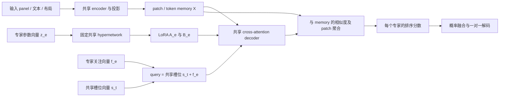

# Vector Expert 系统设计：固定 Hypernetwork 生成 LoRA，与专家 Feature Query

日期：2026-11-06。本文是基于本地源码的设计方案，尚未实现或验证模型效果。

## 1. 目标与建议

目标是让多个专家共享一个 decoder：每个专家用一个可学习向量，经同一套固定 hypernetwork 生成该 decoder 的 LoRA；另外配置一个可学习 feature vector，引导专家从输入中提取不同的信息。

建议将专家表示定义为两个独立学习的向量：

\[
v_e=[z_e;f_e],\qquad
\theta_e^{\mathrm{LoRA}}=H_{\mathrm{fixed}}(z_e),\qquad
q_{e,t}=s_t+f_e.
\]

- `z_e`：参数向量，决定专家如何处理信息；仅输入 hypernetwork。
- `f_e`：关注向量，决定专家以什么 query 读取信息；直接进入 cross-attention decoder。
- `s_t`：所有专家共享的输出槽位向量。对于排序任务，`t` 表示第几个排序位置。
- 共享 encoder、decoder 基础权重、槽位向量和输出头在专家学习阶段冻结；hypernetwork 从初始化开始固定。

这里“一个向量是一个专家”对应可存储的拼接向量 `v_e`；生成 LoRA 的是其中的 `z_e`。若同时学习独立的 `f_e`，专家身份就不能只由 `z_e` 完整描述。可在后续消融中比较 `f_e = R_fixed z_e` 的严格单向量版本，但这会耦合参数能力与关注偏好。

本文将后续的单向量条件化作为**二阶段猜想**：第一阶段先验证独立 `z_e/f_e` 的双向量机制；若两者确有互补作用，第二阶段再尝试由同一个专家向量经另一套共享映射直接生成关注向量，`f_e=G_f(z_e)`。这样部署时每个专家只需保存 `z_e`，LoRA 与 feature 均由共享生成器得到。该假设尚未验证；映射容量、优化稳定性和专家分工效果都需要与独立 `f_e` 基线比较。

首版采用小型、非自回归的 cross-attention 排序 decoder，先验证机制，再考虑大模型 decoder、动态路由或更多专家。本方案保留通用的 LoRA 专家接口，排序任务作为当前仓库的具体落地场景。

## 2. 分析依据与代码索引

分析对象是本地两个目录，而非对原论文所有结论的独立验证。Mapping 仓库 README 自述为非官方复现，并记录了生成激活、初始化增益等实现选择，因此下文把“源码事实”和“本方案扩展”分开。

| 参考项目 | 本地 commit | 主要用途 |
|---|---|---|
| `third_party/Mapping-Networks-Reproduction` | `17a8246316aa2e1267410e263df7c3c67e40b845` | 固定映射、latent 训练、函数式参数注入、正则与保存 |
| `third_party/made2order` | `554be401c0c37033998675e866732be3a43c6e8d` | 可学习 query、cross-attention、patch 到排序槽位的相似度 |

关键源码位置如下；行号对应上述本地版本，链接使用仓库内相对路径。

| 文件与位置 | 阅读重点 |
|---|---|
| [mapping_network.py](../third_party/Mapping-Networks-Reproduction/src/mapping_network.py)，69–170 行 | `MappingNetwork`、固定 buffers、生成公式、Jacobian |
| 同文件，214–322 行 | 冻结 target、`functional_call`、`SingleLatentMapping` |
| 同文件，335–409 行 | `LayerWiseMapping` 的分块与预算分配 |
| [mapping_loss.py](../third_party/Mapping-Networks-Reproduction/src/mapping_loss.py)，45–137 行 | stability / smoothness / alignment 与可学习系数 |
| [trainer.py](../third_party/Mapping-Networks-Reproduction/src/trainer.py)，94–176 行 | optimizer 参数白名单、latent 最优状态恢复 |
| [addons.py](../third_party/Mapping-Networks-Reproduction/src/addons.py)，32–86 行 | 低秩替换，不等同于 LoRA 残差 |
| [model.py](../third_party/made2order/model.py)，90–153 行 | `CrossAttention` 与只有 cross-attention、FFN 的 decoder |
| 同文件，183–243 行 | patch 编码、可学习 query、排序 logits、返回的相似度图 |
| [main.py](../third_party/made2order/main.py)，33–70 行 | 全模型训练、排序监督与 reversible 分支 |
| [made2order_set2order_solver.py](../Solver/agent/made2order_set2order_solver.py)，133–175、212–240 行 | 当前项目设备适配、排序标签逆置换与 CE |

## 3. Mapping-Networks-Reproduction 的实际机制

### 3.1 固定映射仍然允许梯度回传到向量

`MappingNetwork` 注册以下 buffers：`W`、`b`、`w_sq_rowsum`、`out_scale`。它们没有可学习参数；`SingleLatentMapping.latents[0]` 是 `nn.Parameter`。其生成过程是：

\[
g(z)=s\odot\sigma\!\left(Wz+\alpha_m\|z\|_2^2\mathbf 1+b\right),
\quad W\in\mathbb R^{P\times d_z}.
\]

源码默认 `activation="identity"`、`alpha=1e-5`，`W` 用正交初始化。调制项来自把每一行都加上 `alpha*z` 后再乘 `z`，代码用闭式表达式避免显式构造调制后的大矩阵。这里的 `alpha_m` 与 LoRA 的 `alpha_lora` 是两个不同的超参数。

固定的是生成规则及其权重；`W + alpha*z` 的有效调制结果仍随向量变化。这不是必须先训练 hypernetwork 再冻结的方案。

`_BaseMapping` 冻结 target 的原始参数，用 `_param_specs` 固定名称、形状、展平顺序，再把生成参数传入 `torch.func.functional_call`。因此：

\[
\mathcal L\rightarrow\text{target forward}\rightarrow g(z)\rightarrow z
\]

保持可微。不能用 `.data.copy_()`、`load_state_dict()` 或在 `no_grad()` 中生成参数替代训练时的这条路径。

### 3.2 SLVT 与 LWT 应怎样迁移

- SLVT：一个 `z` 生成目标网络的全部参数，最接近“一个向量一个专家”。迁移时把输出目标缩小为 LoRA 的 `A/B` 参数集合。
- LWT：按照层分配多个 latent，每层使用独立 mapper。仍可把多个 latent 拼成一个专家向量，但它们对不同层的影响是分离的。
- LWT 的 mapper 大小是 `sum(P_l*d_l)`，并非所有层都读取完整 `d_z` 的 `sum(P_l*d_z)`。**仅仅分块输出而让每块都读取完整向量，不会减少固定映射总参数量。**

源码按参数比例分配 `d_l`，另有每层最小维度与取整，所以实际维度总和不保证严格等于请求预算；较大参数层占主导时，内存节省也未必达到注释提到的约十倍。

### 3.3 初始化、损失与保存中的可借鉴点

`_build_output_scale()` 使用每个目标张量的 fan-in 标准差，补偿高瘦正交矩阵输出方差过小的问题。这说明生成权重的尺度需要显式设计；其针对整个 CNN/LSTM 的 Kaiming 策略不能直接照搬到 LoRA 残差。

原实现的复合损失为：

\[
\mathcal L_{map}=\mathcal L_{task}
+\lambda_{st}\mathcal L_{stability}
+\lambda_{sm}\mathcal L_{smooth}
+\lambda_{al}\mathcal L_{alignment}.
\]

其中 stability 对 `z+epsilon` 额外前向，与 detach 后的原输出做 MSE；smoothness 解析计算生成参数对 latent 的 Jacobian 平方范数并按输出数归一化；alignment 使用 `1-cos(z, W.mean(0)+alpha*z)`。三个系数以 `softplus(rho)` 学习，optimizer 同时包含 latent 和这些系数。

迁移时有三个限制：

1. 对纯线性固定映射，Jacobian 与 `z` 无关，其平方范数是常数，无法直接约束 `z` 的学习；开启微小调制后也需要检查实际梯度贡献。
2. alignment 针对随机 mapper 的均值方向，不代表语义关注方向，不能作为专家分工监督。
3. 对非负正则直接最小化 `softplus(rho)*L_reg`，存在把系数压低以规避正则的倾向；首版采用固定系数消融。

`latent_state()` 只保存 latent，不保存大矩阵，适合紧凑专家导出。但仅用 seed 重建正交矩阵不应承诺跨 PyTorch 版本、设备或实现的逐位一致；本方案在共享 artifact 中保存固定 buffers 与哈希，专家文件只引用它。

`addons.LowRankLinear` 把原始线性层替换为 `U V^T`，没有保留 `W_0 + delta_W`，因此它提供低秩参数生成思路，不能直接当作 LoRA 包装器。

## 4. Made2Order 的“per-frame 向量”究竟是什么

### 4.1 它是输出排序槽位 query

源码定义：

```python
self.query = nn.Parameter(torch.randn(1, frames, decoder_dim).cuda())
query = self.query.repeat(batch_size, 1, 1)
td_output = self.decoder(query, te_output)
```

这些向量跨样本共享，`repeat` 不产生独立可学习参数。每个 query 可以读取全部输入帧的全部 patch；它没有被绑定到当前输入的第 `i` 帧，也不是为每张训练图存一份 embedding。

从输出与监督可以看出，query 的职责是**排序后的第 `t` 个槽位**。虽然 query 数量配置为 `frames`，但“每输入帧一个关注向量”不是这段实现的准确语义。

### 4.2 query 如何引导信息读取

令编码并投影后的 patch memory 为 `X [B,N*P,D]`，query 为 `Q [B,N,D]`。decoder 有 3 层，每层执行：

\[
Q\leftarrow Q+\mathrm{CrossAttn}(\mathrm{LN}(Q),\mathrm{LN}(X)),
\qquad Q\leftarrow Q+\mathrm{FFN}(\mathrm{LN}(Q)).
\]

它没有 query self-attention，也没有自回归 causal mask。Cross-attention 以 query 生成 Q，以 memory 生成 K/V：可学习 query 通过排序损失逐渐学会提取有助于特定排序槽位的信息。

随后模型归一化 `X` 和 decoder 输出，计算：

\[
C_{b,i,p,t}=\cos(X_{b,i,p},Q'_{b,t}),\qquad
S_{b,i,t}=\frac{\max_p C_{b,i,p,t}}{0.2}.
\]

`S` 的行是输入帧，列是排序槽位；返回的 `attn` 是 `clip(C,0,1)`。**这个可视化图是最终相似度图，既不是 decoder 内部的 softmax attention，也不保证跨 patch 求和为 1。** 后续应分别输出两种图，避免混淆其含义。

上游 `main.py` 对所有模型参数执行 Adam 更新，使用 softmax 后的 BCE；不是仅训练 query。当前项目 wrapper 用 `ranks=argsort(target_order)` 配合 CE，适合作为新方案的标签接口。

### 4.3 迁移边界与需要单独处理的源码问题

- 上游 query 显式 `.cuda()`；位置编码默认在 CUDA，且最初是普通 tensor 属性。当前 wrapper 已做设备补丁并将位置编码改为 buffer；新模块应直接使用正常设备管理，无需复制全局 monkey patch。
- 位置编码含输入帧索引。对于乱序集合，输入槽号不等于真实时间或阅读顺序；首版只保留 panel 内空间位置及已知模态/布局信息，去掉“输入第几帧即时间”的假设。
- `model.py` 的 217–229 行连续复用 `'(b f) n d -> (b n) f d'`，每次只指定 `b`，因此 `f/n` 在每次调用时重新推断。这是反复交换两轴：T1/T3/T5 做 panel 内空间 attention，T2/T4/T6 做跨 panel attention；不能因表达式重复就判断轴变换错误。新模块建议显式维护 `[B,N,P,D]` 并为每步标注实际 shape，便于审核。
- 上游 `utils.ranking_accuracy_mono()` 含固定四帧、CUDA 与特定数据集 mask 路径，不能作为通用排序评估入口。
- 上游支持 reversible 监督，漫画阅读顺序通常有方向性；本任务默认不把逆序当作正确答案。

## 5. 推荐架构

### 5.1 数据流



全部专家共享一份基础 decoder 权重和一套 `H`，禁止为每个专家复制完整模型或单独随机初始化 mapper。专家数增加时只新增向量、训练状态及按需生成的 LoRA。

### 5.2 冻结范围

| 对象 | 共享底座准备阶段 | 专家学习阶段 |
|---|---|---|
| encoder / 输入投影 | 可用预训练权重；是否微调单独记录 | 固定 |
| decoder 基础权重、输出头 | 训练成可用基线 | 固定 |
| 槽位向量 `s_t` | 可学习 | 固定 |
| hypernetwork buffers、LoRA 初始化常量 | 固定初始化 | 固定 |
| 专家 `z_e`、`f_e` | 暂不使用 | 可学习 |
| router | 暂不使用 | 首版不使用；可后置单独训练 |

准备阶段建立有意义的共享特征与 decoder；专家阶段再验证“只学习向量”的适配能力。从头随机冻结一个完整 decoder 再靠很小的 `z/f` 完成任务，不应作为默认可行假设。

### 5.3 LoRA 参数生成

对 decoder 的目标线性投影 `W_0 [d_out,d_in]`：

\[
A_e\in\mathbb R^{r\times d_{in}},\quad
B_e\in\mathbb R^{d_{out}\times r},\quad
y=W_0x+b_0+\frac{\alpha_{lora}}r B_eA_ex.
\]

建议首版只对每层 cross-attention 的 Q、V 投影生成 `A/B`，保留 K、输出投影及 FFN 固定。后续再比较 Q/V/O 或 FFN 扩展。

Made2Order 原版使用融合的 `to_kv`，并且 attention 内部宽度是 `heads*dim_head`，不必等于 `decoder_dim`。实现必须从实际 tensor shape 构造参数表；若只适配 V，应只给融合输出的 V 半部添加低秩残差。新模块建议拆成独立 `q_proj/k_proj/v_proj` 便于审计。

把全部 LoRA 参数按稳定顺序展平，使用共享 mapper：

\[
\{A_{e,l,m},B_{e,l,m}\}_{l,m}
=\mathrm{unflatten}\!\left(H_{fixed}(z_e)\right).
\]

首版用 dense SLVT 作为最容易核对的参考实现；其输出仅覆盖 LoRA，不覆盖基础 decoder 权重、bias 或 LayerNorm。默认先用 identity 激活、`alpha_m=0`，再比较参考实现的 `1e-5` 调制。这是为了分离随机子空间本身与非线性调制的作用，是本方案的实验选择。

### 5.4 适合 LoRA 的初始化

不能把 `A(z)` 和 `B(z)` 都初始化为零，否则乘积对两支的一阶梯度均为零。也不能直接套用整个网络的 Kaiming 输出尺度，让低秩残差一开始就大幅改变底座。

建议设置：

\[
A_e(z)=A_0+s_A\odot g_A(z),\qquad
B_e(z)=s_B\odot g_B(z),\qquad z_e^{(0)}=0,
\]

其中 `g_A(0)=g_B(0)=0`，`A_0` 是共享、固定的 fan-in 随机矩阵，`s_A/s_B` 为固定增益。这样初始 `B=0`，底座输出保持可用，而梯度可经过 `B` 分支回传到 `z`。`f_e` 使用不同随机初始化或经验证的不同关注先验，打破多个专家的完全对称。

两支生成矩阵在后续均可随同一个 `z` 改变。增益在冻结前用固定 probe latent 与少量训练集 calibration 特征确定：记录生成 `A/B` 的标准差、`||delta_W||/||W_0||` 和实际层输出残差比例，控制早期更新尺度。不要用趋近零的真实初始化 `z` 标准差去计算原项目的倒数增益。

另设“小幅随机 `z`、非零初始残差”消融，以判断零起点带来的共同初始化是否限制分工。任何 calibration 不使用测试集。

### 5.5 Feature vector 怎样作用于输入

首版采用 `f_e [D]`，广播到该专家全部输出槽位：

\[
Q_e^{(0)}[b,t,:]=s_t+f_e,\qquad
Q_e'=D_{W_0,H(z_e)}(Q_e^{(0)},X).
\]

`s_t` 区分“第几名”，`f_e` 区分“哪个专家的读取偏好”。每次前向产生的实际关注图依赖输入 `X`，不是存一张固定空间 mask。`f_e` 直接学习，不经过 `H`；梯度通过冻结但可微的 decoder 回到它。

这是对 Made2Order 的扩展：原项目的 query 只区分排序槽位，新方案额外把专家身份加入 query。加法条件化经过 LayerNorm 后的有效容量需要实测；若偏弱，再比较固定投影或共享已训练的条件化模块，不能默认为加一个向量就足以产生明显分工。

备选方案是每个 panel 内都用同一个 `f_e` 做 query，从本 panel patch 中读取信息，再把选出的 panel 特征交给 decoder。它更直接对应“每个专家关注什么局部证据”，但引入了独立 selector，改变了基础结构；应在首版之后作为明确分支比较，避免和原版的排序槽位 query 混为一谈。

### 5.6 输入和输出约定

- 最小视觉版：`memory [B,N,P,D]`，保留 panel 内空间位置，panel 间不注入输入排列位置。
- 多模态版：视觉 patch、OCR token、layout token 投影到同一 `D`，保留模态类型、panel 归属与已知坐标；padding token 必须有 mask。现有数据提供 `dialog_texts` 与 panel layout，若要监督更细的 OCR/人物区域，还需可靠的框与 patch 对齐。
- query：`[B,E,N,D]`；单专家排序 logits：`[B,N,N]`；融合 logits 或概率保持相同轴语义。
- 最终相似度图：`[B,E,N_input,P,N_rank]`；内部 attention 单独保留层、head、query、memory 轴。
- 无效 patch 在 max 聚合前置为负无穷，不可先填零，否则可能压过有效的负余弦值；无效类别在 softmax 前屏蔽。

首版固定 `N=6`。变长支持需要同时屏蔽输入 panel、patch 与输出槽位，并对全无效区域做显式检查；不能仅依赖上游 `frames` 切片。

## 6. 专家分工、训练目标与融合

### 6.1 任务监督及合法排列

复用现有 `target_order`：它是“按正确顺序排列的输入 panel 索引”，模型每行则预测该输入 panel 的 rank。因此：

\[
\mathrm{rank}=\mathrm{argsort}(\mathrm{target\_order}),\qquad
\mathcal L_{task,e}=\frac1{BN}\sum_{b,i}
\mathrm{CE}(S_{e,b,i,:},\mathrm{rank}_{b,i}).
\]

例如 `target_order=[2,0,1]`，则输入 0/1/2 的 rank 为 `[1,2,0]`。误把原序列直接送入 CE 会监督错轴。

独立逐行 argmax 允许多个 panel 预测同一 rank。推理建议对分数或 log 概率执行 Hungarian 一对一分配，得到“输入 panel → rank”，再求逆置换得到 `pred_order`。`N=6` 时也可枚举 720 个合法排列做验证；若继续使用 argmax 后 argsort，需同时报告 rank 冲突率。

### 6.2 为什么双向量本身不保证专家差异

同一任务损失下，多个 `(z_e,f_e)` 可能学到近似功能；向量夹角大也不能证明关注的证据不同。建议分两级实验：

1. **最小机制实验**：所有专家看同样输入，独立随机 `f_e`，平均各专家任务损失；测量是否自然产生差异，不预设“文本专家”等语义标签。
2. **可控分工实验**：为专家提供不同的训练视图，例如视觉外观、OCR 文本、布局或全模态视图；在拥有对齐标注时，对关注图施加区域/模态监督。所有视图仍使用相同排序目标，记录每个视图实际可用的信息。

区域监督可对 decoder 内部 attention 在视觉 patch 上重新归一化后，最小化正确区域 attention 总质量的负对数；也可另设可微 selector 输出作为监督对象。区域中没有有效 token 时跳过该项，不把最终 clipped cosine 图直接当概率使用。

仅给专家取不同名字、让 `f_e` 正交，或惩罚预测一致，都不能保证有用分工。部分样本的不同模态也可能共同指向同一证据，不应强制注意力互斥。首版按任务可用性加弱引导，结合遮挡实验判断。

### 6.3 推荐的起始损失

\[
\mathcal L=\frac1E\sum_e\mathcal L_{task,e}
+\lambda_z\frac1E\sum_e\|z_e\|_2^2
+\lambda_f\frac1E\sum_e\|f_e\|_2^2
+\lambda_{focus}\mathcal L_{focus}.
\]

首版 `lambda_focus=0`，先验证梯度和任务适配；随后用有标注子集或明确的模态视图验证关注引导。stability 作为独立可选项，只扰动 `z`、固定 `f`，控制 dropout 随机性后比较输出分布；其额外 decoder 前向要计入训练成本。初期不默认开启 Mapping 的 smoothness/alignment 或强制输出差异损失。

### 6.4 专家融合与路由

首版默认每个专家前向一次，平均按 rank 归一化的概率：

\[
p(i,t\mid x)=\frac1E\sum_e\mathrm{softmax}_t(S_e(i,:)),
\]

再进行合法排列解码。专家共用监督过的 rank 语义，因此同一列可对齐；不同专家的 logit 尺度及温度需在验证集检查。

后续 router 可从共享 memory 的 masked pooling 预测 `pi_e(x)`，使用加权概率和，再扩展为 top-k。router 应在执行专家前确定选择，才能节省专家前向；先运行所有专家再从其 attention 选专家没有这项计算收益。router 可以先用训练集专家损失产生软目标单独训练，评估覆盖率与负载，必要时再联合优化。

不要平均 `z` 或分别平均 `A/B` 来代替专家输出融合：通常 `H(mean(z))` 不等于 `mean(H(z))`；即使生成器线性，`mean(B)*mean(A)` 也不等于 `mean(BA)`。共享 decoder 的非线性又进一步排除了这种等价性。

### 6.5 二阶段猜想：从专家向量生成 Feature

第一阶段的专家参数为 `(z_e,f_e)`。第二阶段假设可以移除独立可学习的 `f_e`，让一个额外的共享变换从专家向量生成它：

\[
v_e=z_e,\qquad
\theta_e^{\mathrm{LoRA}}=H_{\mathrm{fixed}}(z_e),\qquad
f_e=G_f(z_e),\qquad
q_{e,t}=s_t+f_e.
\]

`G_f` 只在专家间共享，输入为一个专家向量，输出维度为 `d_f`；它不读取当前样本，因而仍是静态专家条件，而不是输入相关 router。可按复杂度递增比较以下实现：

| 变换 | 定义 | 优点与风险 |
|---|---|---|
| 固定线性投影 | `f_e = R_fixed z_e`，`R_fixed` 为固定随机矩阵或预先指定投影 | 无额外可训练参数；表达能力受投影限制，随机投影需跨 seed 检验 |
| 可学习线性变换 | `f_e = W_f z_e + b_f` | 易于审计；`z_e` 同时服务两个分支，可能出现尺度或秩瓶颈 |
| 共享小型 hypernetwork | `f_e = MLP_f(z_e)`，例如两层 MLP 加非线性 | 可表达非线性关系；增加共享参数，且 `G_f` 与 `z_e` 联合训练时有重参数化/可辨识性问题 |

首个对照优先使用线性投影，再评估小型 MLP；保持 `H_fixed` 和其 LoRA 输出不变。可训练 `G_f` 应与所有专家的 `z_e` 联合优化，并用独立 `f_e` 方案作对照；若目标是增量添加新专家，则在已训练完的 `G_f` 上冻结它，只优化新专家的 `z_e`。不能只训练好一组 `z_e` 后冻结随机 `G_f`，再把结果解释为一般的向量到 feature 映射能力。建议记录 `||f_e||`、各专家 feature 的协方差/有效秩、任务表现与关注干预，检查映射是否塌缩到近似常量或忽略输入。

该方案严格减少的是**每个专家单独存储的自由参数**：载荷从 `z_e` 加 `f_e` 变成仅 `z_e`；共享 `G_f` 的参数、训练状态和计算仍计入总成本。它也施加了 `f_e` 必须由 `z_e` 决定的约束，不能预设优于独立双向量。若 `z_e` 需要同时编码 LoRA 适配与关注偏好，可能需要提高维度或使用有容量的 `G_f`，因此要对齐总参数预算和专家载荷报告。

## 7. 容量、内存与计算预算

### 7.1 参数量不能只统计可学习向量

设 LoRA 总参数为 `P`，dense mapper 输入维度为 `d_z`，专家 feature 维度为 `d_f`：

\[
P=\sum_{l,m}r(d_{in,l,m}+d_{out,l,m}),\quad
\text{专家可学习参数}=E(d_z+d_f),\quad
\text{固定主矩阵}=P d_z.
\]

mapper 还需要 bias、scale、可选行范数缓存；基础模型、训练激活、向量的 optimizer 状态和生成后的 LoRA 缓存也要计入。冻结权重省去相应 optimizer 状态，但不自动消除对输入或向量求梯度所需的 activation。

**可控首版示例**：自定义 decoder 使用 `D=256`、3 层、每层 Q/V 两个 `256×256` 投影，`r=4`、`d_z=d_f=256`：

- `P=3*2*4*(256+256)=12,288`。
- 固定 `W` 为 `12,288*256=3,145,728` 元素，FP32 约 **12 MiB**。
- 每专家 `512` 个标量，FP32 向量载荷 **2 KiB**；不含文件元数据、共享 artifact 或 optimizer。
- 每专家生成 LoRA 为 `12,288` 元素，FP32 **48 KiB**。

该配置是新模块的建议值，并非上游 `decoder_dim=64, heads=4, dim_head=64` 的默认尺寸。

若比较具有相同 feature vector 的独立 LoRA 专家，两者都包含 `E*d_f`，仅按主矩阵与专家载荷计算，dense mapper 方案在 `E > P*d_z/(P-d_z)` 后才更省总存储；上述例子约需 **262 个专家**，还未计 mapper 辅助 buffers。对于 4 或 8 个专家，主要收益是可学习自由度与增量专家文件变小，不应宣称总模型内存更低。

**放大风险示例**：32 层、Q/V 均为 `4096×4096`、`r=8` 时，`P=4,194,304`；`d_z=256` 的 dense mapper 单是 FP32 主矩阵就需要 **4 GiB**。因此不能仅凭“每个专家只有一个向量”直接扩展到大 decoder。

### 7.2 扩展时的选择

| 生成方式 | 固定主映射成本 | 对专家向量的约束 | 建议 |
|---|---:|---|---|
| dense SLVT | `P*d_z` | 每个输出都可读完整向量 | 小 decoder 参考实现 |
| LWT / block-sparse | `sum(P_l*d_l)` | 向量分块，每块影响指定层 | 首个内存优化分支 |
| 结构化随机投影 | 依具体算法，可避免显式大矩阵 | 可达参数空间改变 | 单独实现与评估，不称等价替换 |
| 小型共享条件生成器 | 依架构与输出头而定 | 固定随机网络表达能力需验证 | 不能只缩隐藏层、忽略大输出头 |

固定随机映射的像空间受 `d_z` 限制；参数生成目标存在良好低维解，不代表任意随机映射都能到达该解。需要对照独立 LoRA 基线并扫描 latent 维度。如果固定随机映射始终欠拟合，再考虑“先训练共享 hypernetwork、专家扩展时冻结”的另一个研究设定，并明确其共享训练成本及与当前核心设定的差别。

### 7.3 运行成本与缓存

- 共享 encoder 只前向一次；专家 query 与 LoRA 不同，decoder 通常需要执行 `E` 次，或 top-k 时 `k` 次。
- dense 参数生成约 `O(E*P*d_z)`；每次训练更新后必须重新生成，不能沿用 detach 缓存。
- 推理向量固定时，可缓存活跃专家的 LoRA；内存随缓存的专家数增加。仅生成后暂用一个专家，可降低峰值存储。
- 训练逐专家计算并缩放 loss 后 backward，可释放各 decoder 图；若 encoder 也参与学习，需重新设计共享图保留或梯度累积，不能直接复用已释放的图。
- “共享参数”表示权重存储复用，并不表示多个专家的 attention 计算或输出完全共用。

## 8. 实现接口与训练流程

### 8.1 建议新增模块

以下是拟议路径，目前均未实现；第三方源码保持为参考，项目侧使用独立命名空间，避免两个参考项目顶层 `utils` 等导入冲突。

```text
Solver/model_code/vector_experts/
  expert_bank.py          # z/f、专家选择、参数白名单
  fixed_hypernetwork.py   # dense / 分块固定映射，稳定参数表
  generated_lora.py       # 基础线性层 + 可微 A/B 残差
  query_decoder.py        # 共享槽位、cross-attention、mask、可选 attention 导出
Solver/agent/vector_expert_ordering_solver.py
Solver/train_vector_expert_panel_ordering.py
Solver/test_vector_expert_panel_ordering.py
```

复用 [panel_ordering_dataset.py](../Solver/data/panel_ordering_dataset.py) 的数据读取、split、collate 和标签定义。已有 Made2Order wrapper 可作为上游行为基线；新结构需要独立报告，不能替换其内部实现后仍称为原版结果。

当前 [mangazero_qwen_vl_autoregressive.py](../Solver/agent/mangazero_qwen_vl_autoregressive.py) 的 PEFT LoRA 装在 VLM backbone，上面另有 pointer decoder。未来接入时必须指定究竟适配哪一个 decoder；不能把该已有 PEFT 配置直接理解为本方案的共享排序 decoder LoRA。

### 8.2 核心接口

```python
memory, token_mask, panel_index = encode(batch)  # 所有专家共享
z, f = expert_bank.select(expert_ids)
lora = hypernetwork.generate(z)                  # 保留到 z 的计算图
queries = slot_queries[None, :, :] + f[:, None, :]
states, cross_attn = decoder(memory, queries, lora, token_mask)
scores, similarity = rank_head(states, memory, panel_index, token_mask)
```

上面是数据流伪代码，省略了 batch 与 expert 轴的广播，不能直接当成现成 API 调用。首版逐专家循环以明确 shape 和梯度，再考虑 batch/vmap 优化。

训练时建议让自定义线性模块直接执行低秩分支；若使用 `functional_call`，仅替换 LoRA 参数，并严格验证基础权重的名称与覆盖范围。不能每次前向创建新的 `nn.Parameter(A_generated)` 或用 PEFT 权重加载接口注入生成参数，否则会切断 latent 的计算图。

### 8.3 分阶段执行

1. **共享底座**：训练视觉排序基线，确认正确的轴、mask、标签与合法排列解码；保存 encoder、decoder、槽位及输出头。
2. **单专家机制验证**：冻结底座与 `H`，只学习 `z/f`；分别运行 `z-only`、`f-only` 与双向量，检查任务损失能下降。
3. **多专家**：增加独立 `f_e`，保持 mapper 共享；先用全部专家均匀训练、均匀融合，再加入可控分工。
4. **关注验证**：加入模态/区域监督，测量遮挡与专家交换后的行为，确认关注向量有因果作用。
5. **二阶段映射猜想**：仅在双向量基线可复现后，替换独立 `f_e` 为 `R_fixed z_e`、可学习线性变换或共享 `G_f(z_e)`；先联合训练 `G_f` 与专家向量，再单独验证冻结 `G_f` 后新专家是否能仅靠 `z_e` 适配。对齐专家数、底座、训练预算，并保留独立 `f_e` 对照。
6. **扩展**：在小模型结果成立后，加入分块映射、top-k router，最后再接入更大 decoder。

冻结 encoder 且输入路径没有可学习部分时，可在 `no_grad()` 中编码；**冻结 decoder 仍须正常开启 autograd**，使梯度回到专家向量。双向量阶段 optimizer 只包含被选中的 `z/f`；二阶段联合训练 feature hypernetwork 时，明确将 `G_f` 加入 optimizer，完成映射训练后的增量专家适配则冻结 `G_f`、只更新新专家 `z_e`。其他新增可学习 router 或损失系数也须显式列入训练配置。

### 8.4 检查点与可复现性

共享 artifact 保存基础模型标识及权重哈希、所有固定映射 buffers、`A_0`、增益、槽位向量、输出头、参数名称/形状/展平顺序、预处理与结构配置。双向量专家文件保存 `expert_id`、`z_e/f_e`；二阶段生成方案的专家文件只需保存 `z_e`，共享 artifact 还须保存 `G_f` 的结构、权重或固定投影及其版本。两种格式都记录共享 artifact 哈希及版本。

训练恢复文件额外包含 optimizer、scheduler、RNG 状态与训练进度。推理缓存不作为专家的唯一来源；加载时严格核对共享 artifact 和参数表，拒绝把相同长度但不同布局的向量静默解释为另一个模型。

## 9. 实验矩阵与验收条件

### 9.1 建议起始配置

```yaml
# 方案示例；不是已实现的配置入口
panel_count: 6
num_experts: 4
decoder_dim: 256
decoder_layers: 3
num_heads: 4
dim_head: 64
latent_dim: 256
feature_dim: 256
lora_rank: 4
lora_alpha: 4
lora_targets: [cross_attn.q_proj, cross_attn.v_proj]
mapping_type: dense_slvt
mapping_activation: identity
mapping_alpha: 0.0
latent_init: zeros
feature_init: independent_normal
expert_stage_freeze_base: true
fusion: mean_probability
decode: hungarian
```

latent 维度先扫描 `{64,256,1024}`，LoRA rank 扫描 `{2,4,8}`，专家数从 `{1,4,8}` 开始；一次只扩一个主要变量。至少使用三个随机种子，同时记录生成矩阵的 seed 与向量初始化 seed。

### 9.2 必要对照

| 实验 | 参数路径 | 关注路径 | 回答的问题 |
|---|---|---|---|
| 冻结共享基线 | 无专家 LoRA | 共享槽位 | 底座能力 |
| 独立 LoRA 专家 | 直接学习 A/B | 与候选相同的共享 query | 随机低维参数化的容量代价 |
| `z-only` | 固定 H 生成 A/B | 无专家 feature | 参数向量的作用 |
| `f-only` | 无专家 LoRA | 学习专家 feature | query 条件化的作用 |
| 双向量 | 固定 H 生成 A/B | 学习专家 feature | 两者是否互补 |
| 独立 LoRA + feature | 直接学习 A/B | 学习专家 feature | 完整方案的直接参数基线 |
| 单向量 + 固定投影 | 固定 H 生成 A/B | `R_fixed z` | 无额外学习参数时能否生成有效关注条件，以及独立关注自由度是否必要 |
| 单向量 + 可学习线性变换 | 固定 H 生成 A/B | `W_f z+b_f` | 线性共享映射是否足够 |
| 单向量 + 共享 feature hypernetwork | 固定 H 生成 A/B | `G_f(z)` | 非线性生成是否改善适配或关注分工 |
| 分工 / 不分工 | 相同 H 与预算 | 相同 feature 结构 | 外部引导是否带来有用差异 |
| dense / 分块、调制开关 | 对齐总 latent 预算 | 相同 | 映射结构与共模项的影响 |

底座、输入信息、训练样本、解码方式和超参搜索预算应对齐；同时报告直接 LoRA 与向量方法的可学习参数、固定参数、总 artifact 大小与耗时。多专家结果必须对照同预算训练的独立专家集成，区分参数化收益与普通 ensemble 收益。

### 9.3 任务能力与关注行为

- 任务：exact match、position accuracy、pairwise accuracy；合法排列率与解码前 rank 冲突率。
- 专家：单专家成绩、均匀融合成绩、每样本最佳专家 oracle 上界；若 oracle 有优势但融合没有，优先检查融合或路由。
- 关注：内部 attention、最终相似度图、有效区域质量、不同专家关注重叠。可视化相似不等于功能相同，可视化不同也不等于有用。
- 因果检查：固定 `z` 交换或置零 `f`；固定 `f` 交换 `z`；遮挡关注区域和等面积随机区域；分别去除 OCR、layout 或视觉信息，比较各专家性能下降。
- 资源：峰值显存、共享 artifact 与专家载荷大小、参数生成时间、encoder/每专家 decoder/融合的延迟。
- 泛化：至少保持源页面不跨 split；进一步用 work/book 分组测试跨作品泛化。现有按页 split 不能自动证明跨作品泛化。

### 9.4 实现验收

1. 训练时底座与 LoRA 用的 `H_fixed` 不变；按实验设定只更新 `z/f`，或显式声明同时训练的 `G_f`。所有可训练向量和映射梯度有限，并能产生有效更新。
2. `z=0` 时 LoRA 残差为零，但 `z` 仍可获得梯度；输出始终符合定义的 rank 轴语义。
3. 对 input panel 做置换并同步重映射标签后，输出行相应置换；加入 padding 不改变有效内容的结果。以此检查是否依赖任意输入槽号。
4. 相同共享 artifact 与专家文件重载后，输出在约定 dtype 容差内一致；缓存与即时生成结果一致。
5. 相同 `z`、不同 `f` 必须能通过有效 query 路径改变读取；相同 `f`、不同 `z` 必须能改变低秩分支。若训练后两者之一基本被忽略，应先分析退化原因。
6. 双向量方案是否成立，以匹配基线、跨 seed 稳定性和上述关注干预结果判断；不预先承诺优于直接 LoRA，也不把不同向量本身作为专家分工成功的证据。
7. 二阶段生成方案必须确认 `G_f(z_e)` 对 `z_e` 可微、梯度有限且能更新；不同专家的输出不得塌缩为相同或近似常量 feature。冻结已训练的 `G_f` 后，新专家应能仅优化 `z_e` 并获得有效适配；报告与独立 `f_e` 基线对齐预算后的任务指标、关注干预、共享映射成本和每专家载荷。

## 10. 当前结论与验证边界

两个参考项目提供了可衔接的机制：Mapping 的固定可微映射可以改为生成 LoRA 参数；Made2Order 的 learned query 可以扩展为“共享排序槽位 + 专家关注向量”。它们并未现成实现双向量专家、多专家融合或由单个 query 自动产生语义分工。由专家向量经第二个共享映射生成 feature 是本文新增的二阶段猜想，需要通过映射容量、联合优化和关注干预实验验证。

目前完成的是源码静态分析、公式推导与结构设计。本次环境的 `python3` 中没有 `torch/einops/pytest`，因此未运行参考训练或梯度测试。本文所有性能与容量收益均作为实验问题，内存数字是按指定 tensor 尺寸与 dtype 计算的理论值。
